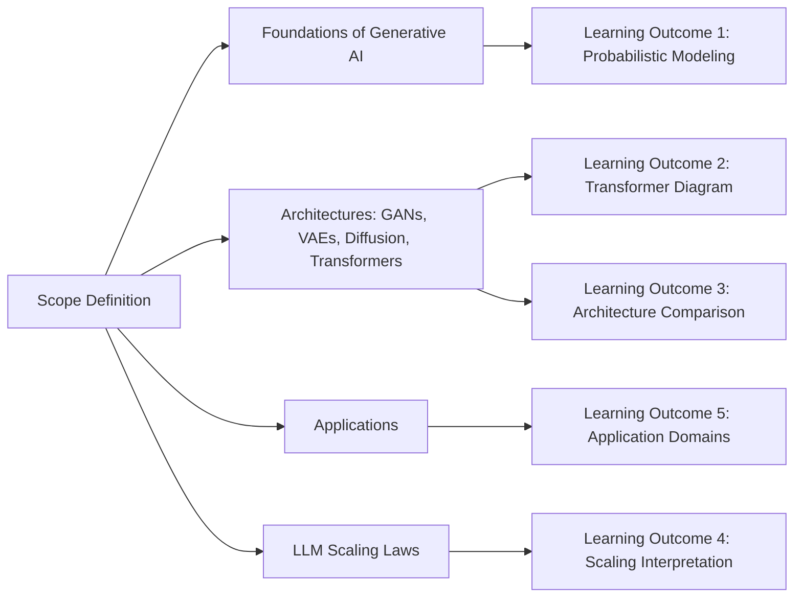
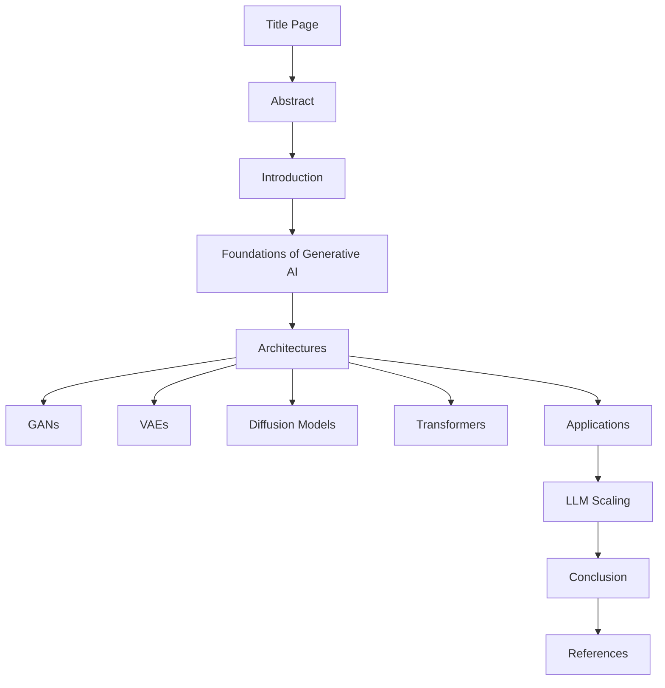
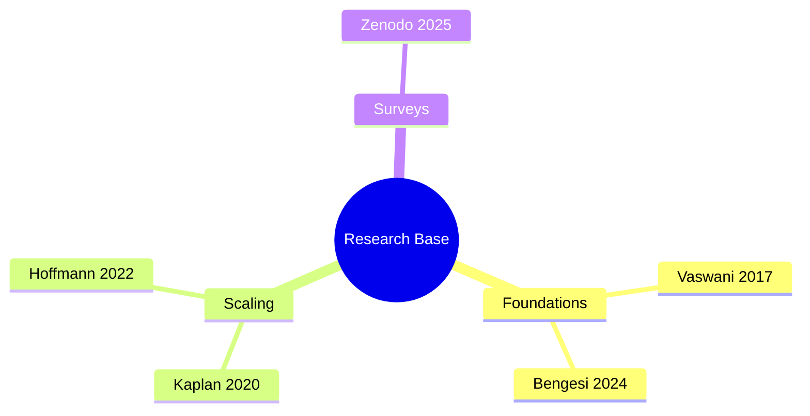
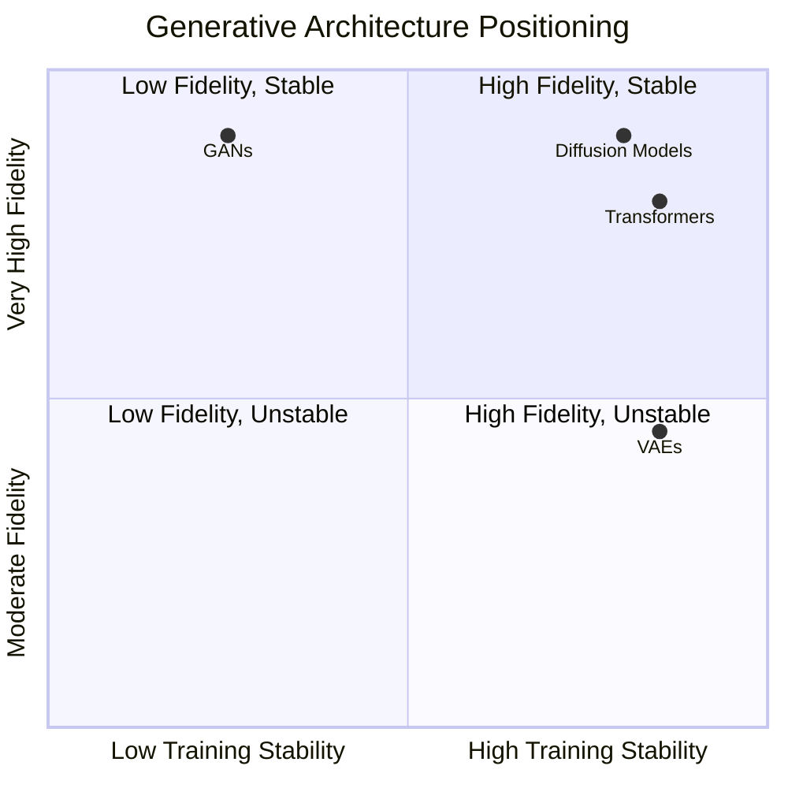
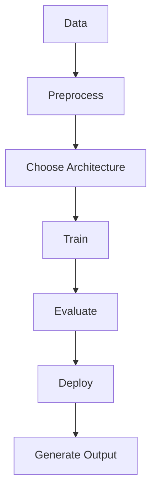
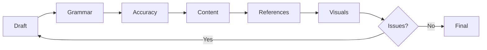

# Aim:	Comprehensive Report on the Fundamentals of Generative AI and Large Language Models (LLMs)
Experiment:
Develop a comprehensive report for the following exercises:
1.	Explain the foundational concepts of Generative AI. 
2.	Focusing on Generative AI architectures. (like transformers).
3.	Generative AI applications.
4.	Generative AI impact of scaling in LLMs.

# Algorithm: Step 1: Define Scope and Objectives
1.1 Identify the goal of the report (e.g., educational, research, tech overview)
1.2 Set the target audience level (e.g., students, professionals)
1.3 Draft a list of core topics to cover
Step 2: Create Report Skeleton/Structure
2.1 Title Page
2.2 Abstract or Executive Summary
2.3 Table of Contents
2.4 Introduction
2.5 Main Body Sections:
•	Introduction to AI and Machine Learning
•	What is Generative AI?
•	Types of Generative AI Models (e.g., GANs, VAEs, Diffusion Models)
•	Introduction to Large Language Models (LLMs)
•	Architecture of LLMs (e.g., Transformer, GPT, BERT)
•	Training Process and Data Requirements
•	Use Cases and Applications (Chatbots, Content Generation, etc.)
•	Limitations and Ethical Considerations
•	Future Trends
2.6 Conclusion
2.7 References
________________________________________
Step 3: Research and Data Collection
3.1 Gather recent academic papers, blog posts, and official docs (e.g., OpenAI, Google AI)
3.2 Extract definitions, explanations, diagrams, and examples
3.3 Cite all sources properly
________________________________________
Step 4: Content Development
4.1 Write each section in clear, simple language
4.2 Include diagrams, figures, and charts where needed
4.3 Highlight important terms and definitions
4.4 Use examples and real-world analogies for better understanding
________________________________________
Step 5: Visual and Technical Enhancement
5.1 Add tables, comparison charts (e.g., GPT-3 vs GPT-4)
5.2 Use tools like Canva, PowerPoint, or LaTeX for formatting
5.3 Add code snippets or pseudocode for LLM working (optional)
________________________________________
Step 6: Review and Edit
6.1 Proofread for grammar, spelling, and clarity
6.2 Ensure logical flow and consistency
6.3 Validate technical accuracy
6.4 Peer-review or use tools like Grammarly or ChatGPT for suggestions
________________________________________
Step 7: Finalize and Export
7.1 Format the report professionally
7.2 Export as PDF or desired format
7.3 Prepare a brief presentation if required (optional)

# Prompt:
```
Comprehensive Report on the Fundamentals of Generative AI and Large Language Models (LLMs)
Experiment: Develop a comprehensive report for the following exercises:

Explain the foundational concepts of Generative AI.
Focusing on Generative AI architectures. (like transformers).
Generative AI applications.
Generative AI impact of scaling in LLMs.

prompt for each step 
Step 1: Define Scope and Objectives

Act as an academic guide. Define the goal, target audience, objectives, key topics, and learning outcomes for a report on Generative AI and LLMs. Use simple language and bullet points.

Step 2: Create Report Structure

Act as a technical writer. Create a report outline on Generative AI and LLMs, including the title page, abstract, introduction, main topics, conclusion, and references. Briefly describe each section.

Step 3: Research and Data Collection

Act as an AI research assistant. Find five reliable research papers or official sources about Generative AI, Transformers, and LLM scaling. Include titles, authors, years, links, and key findings.

Step 4: Content Development

Act as an AI expert. Explain Generative AI fundamentals, GANs, VAEs, diffusion models, Transformers, applications, and LLM scaling using simple explanations, examples, and a comparison table.

Step 5: Visual and Technical Enhancement

Create a Transformer architecture diagram, a Generative AI workflow flowchart, and a comparison table of GANs, VAEs, diffusion models, and Transformers for my report.

Step 6: Review and Edit

Act as an academic reviewer. Check my Generative AI report for grammar, technical accuracy, missing content, and references. List the issues and suggest corrections. Report: [Paste text].

Step 7: Finalize and Export

Act as a document formatter. Give me a checklist for formatting my Generative AI report, adding diagrams and references, proofreading, and exporting the final document as a PDF.

give me both text output and image for each step
```

# Output
Step 1: Define Scope and Objectives
Text Output (Academic Guide Perspective)

Goal: Produce a concise, evidence-based academic report that explains how generative AI works, how Transformer architectures enable modern LLMs, where generative systems are applied, and what happens when LLMs are scaled.

Target Audience: Undergraduate or early graduate students in computer science, data science, or AI; technical professionals entering the field; instructors who need a structured teaching reference.

Objectives:

Define generative AI and distinguish it from discriminative AI.

Compare the four dominant generative architecture families: GANs, VAEs, diffusion models, and Transformers.

Explain the Transformer’s attention mechanism and encoder–decoder structure.

Survey major application domains of generative AI.

Analyze empirical scaling laws for LLMs, including the Kaplan and Chinchilla findings.

Key Topics: Generative modeling fundamentals; GANs; VAEs; diffusion models; Transformer architecture; self-attention and multi-head attention; LLM applications; scaling laws; compute-optimal training; ethical and environmental considerations.

Learning Outcomes: By the end of the report, readers should be able to:

Explain why generative models learn probability distributions rather than decision boundaries.

Diagram the Transformer encoder–decoder pipeline.

Compare generative architectures on fidelity, training stability, and scalability.

Interpret power-law scaling relationships and explain why Chinchilla changed LLM training practice.

Identify at least five application domains and their associated risks.



## Step 2: Create Report Structure

**Text Output (Technical Writer Perspective)**

| **Section** | **Brief Description** |
|---|---|
| **Title Page** | Report title, author, institution, date, and a one-sentence subtitle summarizing the scope. |
| **Abstract** | 150–250 word summary covering the four exercise areas: foundations, architectures, applications, and scaling. |
| **1. Introduction** | Motivation for Generative AI, the shift from discriminative to generative modeling, and the report roadmap. |
| **2. Foundations of Generative AI** | Definition of generative modeling; latent variable models; maximum likelihood and adversarial training; the generation pipeline from data to sampling. |
| **3. Generative AI Architectures** | Dedicated subsections for GANs, VAEs, diffusion models, and Transformers; attention mechanism; encoder–decoder design; autoregressive generation. |
| **4. Generative AI Applications** | Text generation, image synthesis, code generation, drug discovery, synthetic data, and multimodal systems. |
| **5. Impact of Scaling in LLMs** | Kaplan scaling laws; Chinchilla compute-optimal scaling; emergent abilities; diminishing returns; environmental cost. |
| **6. Conclusion** | Synthesis of the four areas; outlook for efficient architectures and responsible scaling. |
| **References** | APA or IEEE style; all sources cited in the body. |



## Step 3: Research and Data Collection

**Text Output (AI Research Assistant Perspective)**

| **#** | **Source** | **Authors & Year** | **Link** | **Key Findings** |
|---|---|---|---|---|
| **1** | *Attention Is All You Need* | Vaswani et al., 2017 | [https://arxiv.org/abs/1706.03762](https://arxiv.org/abs/1706.03762) | Introduced the Transformer, dispensing with recurrence and convolutions entirely; achieved 28.4 BLEU on WMT 2014 English-to-German and 41.8 BLEU on English-to-French after 3.5 days on eight GPUs. |
| **2** | *Scaling Laws for Neural Language Models* | Kaplan et al., 2020 | [https://arxiv.org/abs/2001.08361](https://arxiv.org/abs/2001.08361) | Cross-entropy loss scales as a power law with model size, dataset size, and training compute; larger models are significantly more sample-efficient, favoring training very large models on relatively modest data and stopping before convergence. |
| **3** | *Training Compute-Optimal Large Language Models* | Hoffmann et al., 2022 | [https://arxiv.org/abs/2203.15556](https://arxiv.org/abs/2203.15556) | Current LLMs are significantly undertrained; for compute-optimal training, model size and training tokens should be scaled equally. Chinchilla (70B parameters, 4× more data than Gopher) outperforms 280B Gopher, 175B GPT-3, and 530B Megatron-Turing NLG, reaching 67.5% on MMLU. |
| **4** | *A Comprehensive Survey on Large Language Models: Architectures, Applications, and Ethical Considerations* | 2025 (Zenodo) | [https://zenodo.org/records/15301159](https://zenodo.org/records/15301159) | Surveys Transformer-based designs and scaling strategies behind GPT-4, Gemini, and LLaMA; covers healthcare, finance, education, and public administration applications; highlights algorithmic bias, disinformation, privacy, and environmental impact. |
| **5** | *Advancements in Generative AI: A Comprehensive Review of GANs, GPT, Autoencoders, Diffusion Model, and Transformers* | Bengesi et al., 2024 (IEEE Access) | [DOI: 10.1109/ACCESS.2024.3397775](https://doi.org/10.1109/ACCESS.2024.3397775) | Reviews the post-ChatGPT surge in generative tools, including Bard, Stable Diffusion, DALL·E, Make-A-Video, Runway ML, and Jukebox; covers text generation, music, image creation, video production, code generation, and scientific work. |



**Step 4: Content Development**

**Text Output (AI Expert Perspective)**

**4.1 Generative AI Fundamentals**

Generative AI models learn the **probability distribution** of training data, `p(x)`, so they can **sample new data points** rather than simply classify existing ones. A discriminative model learns `p(y|x)`; a generative model learns `p(x)` or `p(x,y)`. This distinction is the conceptual foundation for generative modeling.

**4.2 GANs (Generative Adversarial Networks)**

A GAN consists of two networks: a **generator** that turns random noise into synthetic samples, and a **discriminator** that tries to distinguish real data from generated data. Training is a minimax game. GANs can produce sharp images but may be unstable to train and prone to mode collapse.

**Example:** StyleGAN generates realistic human faces by progressively refining images from coarse to fine details.

**4.3 VAEs (Variational Autoencoders)**

A VAE learns a **latent space** by encoding inputs into a probability distribution, typically represented by a mean and variance, and decoding samples back into the data space. Its training objective balances reconstruction accuracy against a KL-divergence regularizer that encourages a smooth latent space. VAEs provide structured, interpolatable latent representations, although their outputs can sometimes be blurry.

**Example:** A VAE trained on handwritten digits can interpolate between the digits “3” and “8” in latent space to generate intermediate digit shapes.

**4.4 Diffusion Models**

Diffusion models learn to **reverse a gradual noising process**. During training, noise is added to data over multiple steps, and the model learns to predict or remove that noise. During generation, the model starts with noise and iteratively denoises it to produce a sample. Diffusion models can generate high-quality images and generally offer more stable training than GANs.

**Example:** Stable Diffusion uses latent diffusion to generate images from text prompts.

**4.5 Transformers**

The Transformer replaces recurrence with **self-attention**. Each token attends to other tokens in the sequence, producing context-aware representations. The original Transformer architecture contains an **encoder** to represent the input and a **decoder** to generate the output. **Multi-head attention** enables the model to learn different relationships between tokens.

**Example:** GPT models are decoder-only Transformers that predict the next token, while BERT is an encoder-only Transformer primarily designed for language understanding tasks.

**4.6 Applications of Generative AI**

- **Text generation and dialogue:** GPT, Gemini, and LLaMA.
- **Image synthesis and editing:** Stable Diffusion, DALL·E, and Midjourney.
- **Code generation:** GitHub Copilot and code-generation models.
- **Drug discovery and protein design:** Generative models for molecular structures and protein design.
- **Synthetic data generation:** GANs and diffusion models for creating artificial datasets.
- **Multimodal generation:** Systems that generate or process combinations of text, images, audio, and video.

**4.7 Impact of Scaling in LLMs**

**Kaplan Scaling Laws (2020)**

Kaplan et al. showed that language-model loss follows power-law relationships with model size, dataset size, and training compute. Their findings highlighted the benefits of increasing model size and helped establish scaling laws as a framework for allocating computational resources.

**Chinchilla Scaling (2022)**

Hoffmann et al. found that compute-optimal training requires balancing model size with the number of training tokens. Their Chinchilla model, with 70 billion parameters trained on approximately 1.4 trillion tokens, outperformed several larger models on the evaluated benchmarks, demonstrating that training data quantity and model size must be considered together.

**Practical Implications of Scaling**

- **Emergent abilities:** Some capabilities become more apparent at larger scales, although their measurement and interpretation remain debated.
- **Diminishing returns:** Additional computing resources can produce progressively smaller improvements in model performance.
- **Environmental cost:** Training and serving large models consume substantial energy and computing resources.
- **Efficient scaling:** Modern model development considers data quality, token count, model size, and computational budgets together.

**4.8 Comparison Table: GANs, VAEs, Diffusion Models, and Transformers**

| **Criterion** | **GANs** | **VAEs** | **Diffusion Models** | **Transformers** |
|---|---|---|---|---|
| **Generative mechanism** | Adversarial learning using a generator and discriminator | Latent-variable encoding and decoding | Iterative denoising of noisy data | Often autoregressive next-token prediction using self-attention |
| **Training stability** | Can be unstable and prone to mode collapse | Generally stable with appropriate configuration | Generally stable denoising objective | Depends on architecture, optimization, and training setup |
| **Sample fidelity** | Can generate sharp images | Outputs can sometimes be blurry | Can generate high-quality images | Strong text generation and contextual modeling |
| **Latent representation** | Maps input noise to generated outputs | Learns structured latent representations | Operates in pixel space or a learned latent space | Learns contextual token representations |
| **Scalability** | Can be difficult to train reliably at scale | Scalable, depending on the model and objective | Scalable and widely used in generative systems | Highly scalable and widely used in modern LLMs |
| **Typical applications** | Face generation, image translation, super-resolution | Anomaly detection, interpolation, synthetic data | Text-to-image, image editing, video generation | Language models, translation, code generation, multimodal AI |



Step 5: Visual and Technical Enhancement
Text Output

Use a Transformer encoder–decoder diagram with multi-head attention, feed-forward, residual connections, and positional encoding.

Use a generative workflow: data → preprocessing → architecture → training → evaluation → inference → output.

Include the comparison table from Step 4.

Visual 1: Transformer Image URL
https://upload.wikimedia.org/wikipedia/commons/thumb/8/8f/The-Transformer-model-architecture.png/850px-The-Transformer-model-architecture.png


Step 6: Review and Edit
Text Output
No report text was pasted, so use this review checklist:

Grammar: Consistent tense; avoid vague intensifiers; clarify pronouns.

Accuracy: LLMs are a subset of generative AI; Transformers did not fully eliminate RNNs; Chinchilla refines Kaplan.

Missing content: Add positional encoding, application risks, downstream scaling metrics.

References: Add arXiv IDs/DOIs; use one citation style.

Visuals: Caption every figure/table and cite adapted sources.


Step 7: Finalize and Export
Text Output Checklist

Formatting: Consistent font, spacing, margins, page numbers, heading hierarchy.

Visuals: Captions, source notes, sequential numbering, 300 DPI images.

References: All citations matched; DOI/arXiv included; consistent style.

Proofreading: Spell-check, read aloud, define acronyms, verify numbers.

PDF Export: Embed fonts, verify images and links, compress if needed, name file clearly.


# Result
